<h1>Hi, I'm hwdpw</h1>

<b>全栈 · 极简主义者</b>

  <code>Vim</code> · <code>Git</code> · <code>Docker</code> ·
  <code>Golang</code> · <code>MySQL</code> · <code>JavaScript</code>

  <a href="https://hwd.pw">hwd.pw</a> &nbsp;·&nbsp;
  <a href="https://start.hwd.pw">start.hwd.pw</a>

---

### 我的世界

|              |                                                       |
| :----------- | :---------------------------------------------------- |
| **个人世界** | [hwd.pw](https://hwd.pw) — 想法与作品的落脚点         |
| **起始页**   | [start.hwd.pw](https://start.hwd.pw) — 每天上网的起点 |

### 我的思维

> 先弄清「问题是什么」，再谈「怎么解决」。 
> 把复杂拆到足够小，用最简单的方式重新组合。 
> 克制比堆砌更难，也更值得。

### 兴趣

**天文** — 抬头看星星，是给大脑留的一点留白。

### 贡献记录

<picture>
  <source media="(prefers-color-scheme: dark)" srcset="https://raw.githubusercontent.com/hwdpw/hwdpw/output/github-snake-dark.svg">
  <source media="(prefers-color-scheme: light)" srcset="https://raw.githubusercontent.com/hwdpw/hwdpw/output/github-snake.svg">
  
</picture>

---

简约，但不简单

